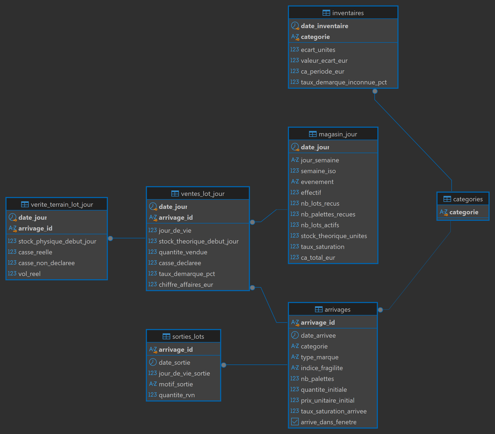
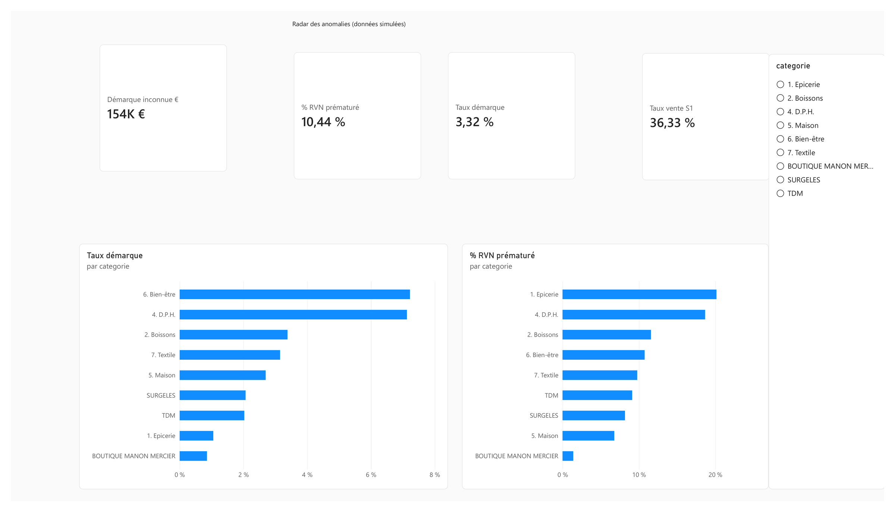

# Projet NOZ : anomalies et prévision en magasin (données simulées)

David DOE · 2026

Projet de portfolio en data analyse : une chaîne PostgreSQL → Python → Power BI pour repérer les lots à risque, la démarque inconnue et les pics d'activité d'un magasin discount.

> Transparence. Aucune donnée interne de NOZ n'est utilisée. Toutes les données viennent d'un simulateur de magasin calé sur les relevés de mon mémoire de stage (L3, NOZ de Saint-Pol-sur-Mer, 2025). Les résultats valident une méthode ; ils ne décrivent pas le vrai magasin.

## Résultats (dans la base simulée)

| Question | Résultat |
|---|---|
| Peut-on repérer les lots renvoyés avant 49 jours (RVN prématurés) ? | Régression logistique : AUC 0,836 à l'arrivée, 0,922 au jour 7. En surveillant 20 % des lots, on repère 65 % des RVN prématurés. |
| Où se concentre la démarque inconnue ? | Bien-être et D.P.H. : 42,5 % de la démarque inconnue pour 19 % du CA. |
| Vend-on plus les jours de livraison ? | Non (p = 0,86). Le samedi fait +35 % de CA, sans livraison. |
| Peut-on prévoir le CA à 7 jours ? | Holt-Winters : 11 % d'erreur, 21,5 % de mieux que la méthode naïve. |

Pour une lecture sans jargon : [résumé métier](resume_metier.md). Pour le cadrage de départ : [cahier des charges](cahier_des_charges.md).

Limites principales : les liens trouvés ont été écrits dans le simulateur, et aucun modèle ne prévoit la saturation elle-même. Le détail est dans le rapport.

## Relancer tout le projet en une commande

Il faut PostgreSQL (version 14 ou plus) et Python 3.11 ou plus.

```bash
pip install -r requirements.txt
python lancer_tout.py
```

Le script demande le mot de passe de l'utilisateur `postgres` (il ne l'enregistre pas), puis :

1. crée la base `noz` ;
2. crée les 7 tables, charge les CSV, lance les 22 contrôles de qualité (il s'arrête si un seul échoue) et crée les 5 vues ;
3. exécute les 3 notebooks et refait les graphiques de `figures/`.

Les données sont fixes et les modèles utilisent une graine aléatoire fixe (`random_state=42`) : on retrouve exactement les chiffres du rapport.

## Contenu du dépôt

| Fichier | Rôle |
|---|---|
| `noz_v2/*.csv` | Les données simulées : 6 fichiers pour 7 tables (la table `categories` est remplie par `01_schema.sql`). |
| `01_schema.sql` | Crée les tables, les clés et les règles de bon sens. |
| `02_charger_donnees.sql` | Charge les CSV. |
| `03_verifications.sql` | Premières requêtes, et 4 insertions fausses que la base refuse (à lancer à la main). |
| `04_controles_qualite.sql` | Les 22 contrôles de qualité (version `_dbeaver` pour DBeaver). |
| `05_vues_indicateurs.sql` | Les 5 vues utilisées par Python et Power BI. |
| `06_tests_hypotheses.ipynb` | Tests statistiques (H1 à H4), figures 1 à 3. |
| `07_modele_rvn.ipynb` | Prédiction du RVN prématuré, figures 4 et 5. |
| `08_prevision_ca.ipynb` | Prévision du CA à 7 jours, figures 6 et 7, export `previsions_7j.csv`. |
| `dashboard_noz.pbix` | Tableau de bord Power BI (3 pages). |
| `figures/`, `captures/` | Graphiques Python, captures du tableau de bord et schéma de la base. |
| `resume_metier.md` | Le résumé métier, en une page, sans jargon technique. |
| `cahier_des_charges.md` | Le cahier des charges de départ : questions, hypothèses, objectifs chiffrés et plan du rapport. |
| `rapport_noz.pdf` | Le rapport complet, avec annexes et preuves. |
| `journal_resultats.md` | Tous les résultats, étape par étape. |

## Base de données

7 tables reliées par des clés étrangères (schéma DBeaver) :



## Tableau de bord



## Outils

PostgreSQL · SQL (contraintes, vues, contrôles) · Python (pandas, SciPy, scikit-learn, statsmodels, matplotlib) · Power BI (DAX, paramètre what-if)
